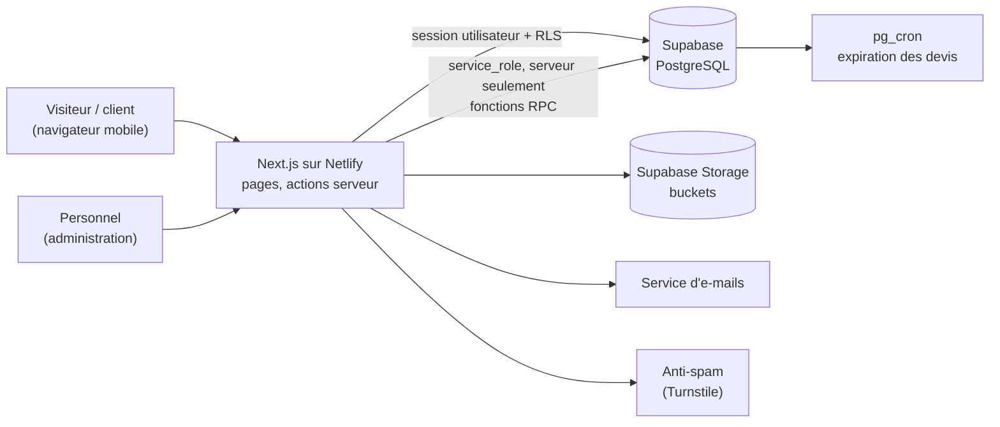

# TRD — Document d'exigences techniques

**Dz Multi-Services** · Version 1.0 · 8 octobre 2026
Liens : [PRD](01-PRD.md) · [App Flow](03-app-flow.md) · [Schéma de données](05-schema-donnees.md) · [Plan d'implémentation](06-plan-implementation.md)

---

## 1. Contexte et contraintes

- Développeur principal unique, assisté par Windsurf ; budget d'hébergement limité ; maintenance simple.
- Usage principalement sur téléphone, connexions variables.
- Données personnelles de clients et de tiers (bénéficiaires), données financières.
- Les noms techniques (tables, colonnes, statuts, code) sont en anglais ; **tout ce que voit l'utilisateur est en français**.
- Les points techniques repris de la documentation de Supabase et de Netlify sont à **reconfirmer au moment du développement** (les versions et noms de variables évoluent).

## 2. Architecture



**Principes**
1. **La base est la source de vérité** : droits (RLS), calculs de totaux, états de règlement, numérotation, journal.
2. Le navigateur ne parle **jamais** à la base avec une clé privilégiée. Le public passe par des actions serveur qui appellent des fonctions SQL à usage unique (`submit_request`, `accept_quote`, etc.).
3. Le personnel parle à la base avec **sa propre session** : RLS s'applique, les déclencheurs contrôlent les transitions.
4. Un seul endroit pour la logique serveur : actions serveur et routes de Next.js. Fonctions Edge de Supabase seulement si un besoin l'impose.

## 3. Pile technique

| Couche | Choix | Remarque |
|---|---|---|
| Framework | Next.js (App Router), TypeScript strict | Version stable courante, Node LTS |
| Interface | Tailwind CSS, shadcn/ui, Lucide | Thème issu de la charte (voir Design Brief) |
| Formulaires | React Hook Form + Zod | Mêmes schémas côté navigateur et côté serveur |
| Données | Supabase : PostgreSQL, Auth, Storage | Client `@supabase/ssr` |
| Graphiques | Recharts | V1 : tableau de bord simple |
| PDF | `@react-pdf/renderer`, côté serveur | Polices Montserrat et Poppins embarquées ; à valider par un essai de déploiement |
| E-mails | Service transactionnel (par exemple Resend) | Domaine authentifié (SPF, DKIM) |
| Anti-spam | Cloudflare Turnstile ou équivalent | Vérifié côté serveur |
| Tests | Vitest, Playwright, tests de base de données | Voir § 11 |
| Hébergement | Netlify (adaptateur Next.js) | Préversions par branche |
| Code | GitHub, branches `main`, `develop`, `feature/*` | |
| Suivi d'erreurs | Sentry (optionnel) | Sans données personnelles |

## 4. Structure du dépôt

```text
dz-multi-services/
  app/
    (public)/            pages du site
    admin/               administration
    api/                 routes techniques (signature d'upload, santé)
  components/            ui/  public/  admin/  forms/  charts/  pdf/
  lib/
    supabase/            client navigateur, client serveur, client service
    auth/                lecture du rôle, gardes de pages
    validations/         schémas Zod par formulaire
    pdf/                 modèles de documents
    utils/
  types/                 types générés depuis la base
  public/brand/          logos, icônes, motifs (SVG et PNG)
  supabase/
    migrations/          0001 à 0004 (voir schéma)
    tests/
  docs/                  les six documents
  AGENTS.md  README.md  .env.example
```

## 5. Application

### 5.1 Routes publiques

| Route | Rendu | Rôle |
|---|---|---|
| `/` | Statique, revalidé à la demande | Accueil |
| `/a-propos`, `/comment-ca-marche`, `/faq`, `/galerie` | Statique, revalidé à la demande | Contenus |
| `/services` | Statique, revalidé à la demande | Liste des services actifs |
| `/services/[slug]` | Statique, revalidé à la demande | Page d'un service |
| `/commander/[slug]` | Dynamique | Formulaire de demande (étapes) |
| `/contact` | Dynamique | Formulaire de contact |
| `/suivi/[token]` | Dynamique, sans cache | Suivi d'une demande |
| `/devis/[token]` | Dynamique, sans cache | Consultation et acceptation d'un devis |
| `/mentions-legales`, `/conditions`, `/confidentialite` | Statique | Pages légales |
| `/sitemap.xml`, `/robots.txt` | Généré | Référencement |

Les pages à jeton sont en `noindex`, sans cache partagé, avec l'en-tête `Referrer-Policy: no-referrer`.

### 5.2 Routes d'administration (toutes dynamiques, sans cache)

`/admin/login`, `/admin/dashboard`, `/admin/requests`, `/admin/requests/new`, `/admin/requests/[id]`, `/admin/quotes`, `/admin/quotes/[id]`, `/admin/payments`, `/admin/customers`, `/admin/customers/[id]`, `/admin/services`, `/admin/messages`, `/admin/settings`, `/admin/users`, `/admin/audit`.
V2 : `/admin/expenses`, `/admin/finance`, `/admin/reports`, `/admin/calendar`, `/admin/gallery`, `/admin/testimonials`, `/admin/faqs`.

### 5.3 Protection de l'administration
1. Rafraîchissement de session dans le `middleware` de Next.js (nommé `proxy` dans les versions récentes ; à vérifier).
2. Le layout d'administration lit le rôle côté serveur et redirige si le compte est absent, inactif ou sans le rôle requis.
3. Chaque page sensible revérifie le rôle ; **RLS reste la protection réelle** : l'interface ne sert qu'à masquer.

### 5.4 Actions serveur et fonctions SQL

| Action serveur | Qui | Appelle |
|---|---|---|
| `submitRequest(formData)` | Public | Turnstile, validation Zod, puis RPC `submit_request` (service_role) |
| `submitContact(formData)` | Public | Turnstile, RPC `submit_contact` |
| `signUpload(fileMeta)` | Public | Turnstile, limite de débit, URL d'envoi signée dans `request-files/incoming/` |
| `getTracking(token)` | Public | RPC `get_request_public` |
| `getPublicQuote(token)` | Public | RPC `get_quote_public` |
| `acceptQuote(token, name)` | Public | RPC `accept_quote` |
| `rejectQuote(token, reason)` | Public | RPC `reject_quote` |
| `requestQuoteChange(token, msg)` | Public | RPC `request_quote_change` |
| `createRequest`, `updateRequest`, `setStatus`, `assign` | Personnel | Session utilisateur, RLS |
| `createQuote`, `saveQuoteItems`, `sendQuote` | Personnel | Session utilisateur ; `sendQuote` réservé aux administrateurs (déclencheur) |
| `recordPayment`, `confirmPayment` | Personnel | Session utilisateur ; confirmation réservée aux administrateurs |
| `generateDocument(type, id)` | Personnel | Génère le PDF, lit le cachet via le client service, enregistre dans `documents` et `generated_documents` |
| `uploadStamp(file)` | Super-administrateur | Vérifie le rôle, écrit dans `agency-assets`, met à jour le réglage |

Règle : le client **service_role** n'est instancié que dans un module serveur dédié (`lib/supabase/service.ts`), importé uniquement par ces actions publiques et par `generateDocument` / `uploadStamp`. Un test automatique vérifie qu'il n'apparaît dans aucun bundle navigateur.

### 5.5 Formulaires
- Étapes courtes, indicateur de progression, récapitulatif avant l'envoi.
- Schémas Zod partagés ; les messages d'erreur sont en français.
- Téléphones : bibliothèque de normalisation (E.164), sélecteur d'indicatif.
- Brouillon du formulaire de mariage en stockage local du navigateur, effacé après envoi.
- Téléversement : l'action `signUpload` valide le type MIME et la taille avant de signer ; les fichiers vont dans `incoming/<uuid>/`. Les vidéos lourdes sont remplacées par un lien.
- Envoi unique : jeton d'idempotence pour éviter les doubles soumissions.

### 5.6 Documents PDF
- Modèles React PDF : devis, fiche de prestation, reçu.
- En-tête : logo en PNG, nom, téléphones, e-mail, adresse lus dans `site_settings`.
- Cachet : lu dans `agency-assets` par le client service, apposé seulement si le document est émis (devis envoyé ou accepté, fiche validée, reçu).
- Le fichier est enregistré dans `documents/<type>/<numéro>-r<révision>.pdf`, puis référencé dans `generated_documents`. Un document émis n'est jamais écrasé.
- Objectif : génération en moins de 5 s ; durée limite des fonctions Netlify à vérifier.

### 5.7 Notifications
- Internes : déclencheurs SQL écrivant dans `notifications`, lues par l'interface (rafraîchissement périodique en V1, temps réel en V2).
- E-mails : envoyés par le serveur après l'événement (demande reçue, devis disponible, paiement confirmé, prestation terminée), avec version texte brut.
- WhatsApp : liens `wa.me` avec message prérempli, générés dans la fiche demande.

## 6. Données et sécurité

### 6.1 Modèle
Voir le [schéma de données](05-schema-donnees.md) et les migrations `supabase/migrations`.

### 6.2 Modèle de menaces

| Menace | Mesure |
|---|---|
| Spam et abus des formulaires | Turnstile, limitation de débit par adresse, validation Zod, taille maximale des corps de requête |
| Énumération des demandes ou des devis | Jetons aléatoires de 192 bits, aucune lecture anonyme des tables, réponses minimales, `noindex` |
| Lecture des données par un visiteur | RLS activé partout, droits retirés au rôle `anon`, accès public limité aux contenus publiés |
| Élévation de privilèges | Rôle lu dans `profiles` (jamais dans les métadonnées modifiables), nul ne peut changer son propre rôle, MFA pour ADMIN |
| Falsification de montants | Totaux calculés par la base, devis figé après envoi, paiement confirmé non modifiable, seul un administrateur confirme |
| Contournement des statuts | Déclencheur de transitions autorisées |
| Fuite de fichiers clients | Buckets privés, URL signées à durée limitée, accès réservé au personnel |
| Fuite ou copie du cachet | Bucket `agency-assets` sans politique, lecture par le serveur seulement, jamais renvoyé au navigateur |
| Fichier malveillant | Liste de types autorisés, taille maximale, noms générés, aucune exécution, analyse antivirus envisagée en V2 |
| Injection (SQL, XSS) | Requêtes paramétrées et RPC, échappement par défaut de React, aucun HTML brut issu des saisies, politique de contenu stricte |
| CSRF | Protection d'origine des actions serveur, cookies `SameSite` |
| Vol de session d'administration | Double authentification, durée de session limitée, déconnexion |
| Fuite de la clé `service_role` | Variable serveur sans préfixe public, test de bundle, rotation en cas de fuite |
| Suppression accidentelle | Suppression logique, interdiction de supprimer les données financières, sauvegardes, journal |

### 6.3 En-têtes et politique de contenu
`Content-Security-Policy` stricte (scripts du domaine, Turnstile, polices hébergées avec le site), `X-Content-Type-Options`, `Referrer-Policy`, `Permissions-Policy`, HSTS. Pages à jeton : `Cache-Control: no-store`.

### 6.4 Données personnelles
Consentement enregistré (`consent_at`), politique de confidentialité, durée de conservation par type de donnée (à fixer), suppression ou anonymisation sur demande, information du bénéficiaire, aucune donnée personnelle dans les journaux applicatifs.

## 7. Performance

| Cible | Valeur |
|---|---|
| LCP page d'accueil, mobile 4G simulée | ≤ 2,5 s |
| Score Lighthouse mobile (performance, accessibilité, bonnes pratiques) | ≥ 90 |
| JavaScript initial des pages publiques | Réduit au nécessaire ; composants de formulaire chargés à la demande |
| Images | WebP ou AVIF, tailles adaptées, chargement différé sous la ligne de flottaison |
| Polices | Hébergées avec le site, sous-ensemble latin, `font-display: swap` |
| Mise en cache | Pages publiques statiques revalidées à la demande après modification dans l'administration |

## 8. Environnements et déploiement

| Environnement | Application | Base |
|---|---|---|
| Local | `localhost` | Projet Supabase local ou de développement |
| Préversion | Netlify, une par branche ou PR | Projet Supabase de **développement** |
| Production | Domaine final | Projet Supabase de **production** |

**Variables d'environnement**

| Variable | Où | Usage |
|---|---|---|
| `NEXT_PUBLIC_SUPABASE_URL` | Navigateur et serveur | URL du projet |
| `NEXT_PUBLIC_SUPABASE_PUBLISHABLE_KEY` | Navigateur et serveur | Clé publique (RLS) |
| `SUPABASE_SERVICE_ROLE_KEY` | **Serveur seulement** | Fonctions RPC publiques, cachet |
| `NEXT_PUBLIC_TURNSTILE_SITE_KEY`, `TURNSTILE_SECRET_KEY` | Navigateur / serveur | Anti-spam |
| `EMAIL_API_KEY`, `EMAIL_FROM` | Serveur | E-mails |
| `APP_URL` | Serveur | Liens dans les e-mails et PDF |
| `SENTRY_DSN` | Serveur (optionnel) | Suivi d'erreurs |

**Intégration continue (GitHub Actions)** : installation, lint, vérification des types, tests unitaires, base de test (rejeu des migrations puis tests), tests de bout en bout sur la préversion. Les migrations de production sont appliquées par une commande manuelle protégée, après validation de la préversion.

**Production Supabase** : offre payante conseillée (les offres gratuites comportent des limites de pause, de sauvegarde et de taille de fichier, à vérifier sur la grille actuelle).

## 9. Observabilité et exploitation

- Journaux Netlify et Supabase, sans données personnelles.
- Contrôle de disponibilité externe sur la page d'accueil et sur une route de santé.
- Alertes : erreurs serveur répétées, échec de génération de PDF, échec d'envoi d'e-mail.
- Sauvegardes automatiques et **test de restauration** avant la mise en production, puis chaque trimestre.
- Tâche planifiée nocturne : `expire_quotes()`, purge des fichiers selon la durée de conservation.

## 10. Conventions de code

- TypeScript strict, ESLint et Prettier, imports absolus.
- Un module par domaine (`requests`, `quotes`, `payments`) ; pas de logique métier dans les composants d'interface.
- Types de base générés à partir du schéma ; aucune requête construite par concaténation.
- Toute valeur monétaire manipulée comme chaîne ou décimal, jamais en nombre flottant ; calculs de référence faits par la base.
- Dates d'événements : date et heure locales sans fuseau ; dates techniques en UTC.
- Aucune couleur ni police en dur : jetons du thème.
- Commits au format `type(portée) : message`, une branche par lot.

## 11. Stratégie de tests

| Niveau | Outil | Couverture |
|---|---|---|
| Unitaires | Vitest | Schémas Zod, calculs d'affichage, utilitaires |
| Base de données | Tests SQL (pgTAP ou équivalent) | RLS par rôle, transitions, totaux, paiements, journal, numérotation |
| Bout en bout | Playwright | Parcours public complet, acceptation de devis, traitement d'une demande, paiement |
| Sécurité | Scripts dédiés | Absence de `service_role` dans les bundles, en-têtes, accès anonyme refusé |
| Accessibilité et performance | Lighthouse, axe | Pages clés en CI |
| Recette | Liste du PRD § 9 | Validation avec l'agence |

Un premier jeu de **50 vérifications** a été exécuté sur les migrations avec un PostgreSQL local (voir schéma de données § 10) ; il sert de base pour les tests pgTAP.

## 12. Décisions d'architecture

| N° | Décision | Raison |
|---|---|---|
| ADR-01 | Next.js + Supabase + Netlify | Un seul développeur, délais courts, RLS native |
| ADR-02 | Soumissions publiques par fonction SQL (`security definer`) appelée par le serveur | Transaction unique, surface d'attaque réduite, aucun accès direct aux tables |
| ADR-03 | Services à la demande traités par un devis simplifié | Un seul circuit pour tout, traçabilité du montant accepté |
| ADR-04 | Sommes de passage marquées sur les lignes de devis | Chiffre d'affaires et résultat justes |
| ADR-05 | Pas de compte client en V1, accès par jetons | Moins de friction, moins de données à protéger |
| ADR-06 | PDF générés côté serveur et archivés | Documents figés, cachet protégé |
| ADR-07 | Dates d'événements sans fuseau | La date d'un mariage ne dépend pas du fuseau du client |
| ADR-08 | Statuts en enums PostgreSQL, listes évolutives en tables | Intégrité et souplesse |
| ADR-09 | Deux projets Supabase (développement, production) | Les préversions n'écrivent jamais en production |
| ADR-10 | Cachet dans un bucket privé sans politique | Lecture par le serveur seulement |
| ADR-11 | Séance photo du formulaire de mariage enregistrée dans la même demande | Reproduit la fiche papier ; les demandes liées servent aux ajouts ultérieurs |

## 13. Risques techniques

| Risque | Parade |
|---|---|
| Génération de PDF trop lente ou impossible en fonction serverless | Essai dès le lot 1 ; bibliothèque légère ; repli sur un service dédié |
| Limites de l'offre gratuite en production | Offre payante, surveillance de l'usage |
| Complexité du formulaire de mariage | Lot dédié, tests de bout en bout, brouillon local |
| Dérive du code produit par l'assistant | `AGENTS.md`, lots courts, revue de chaque PR, tests de non-régression |
| Évolution de Next.js ou de Supabase | Versions figées, mises à jour planifiées, lecture des notes de version |
