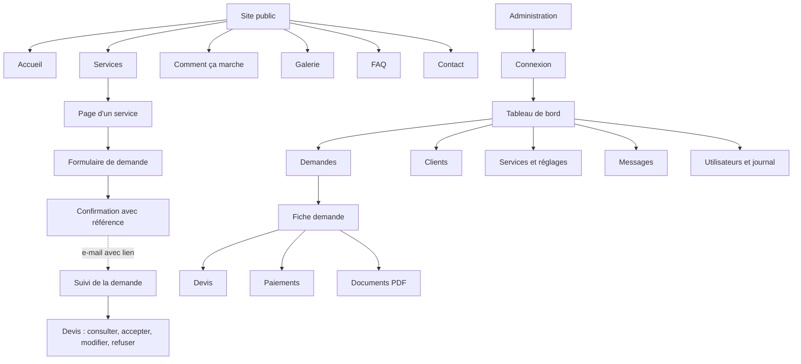
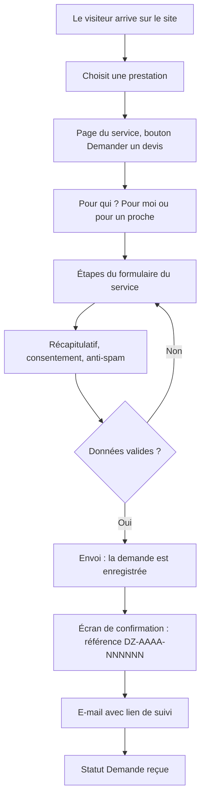
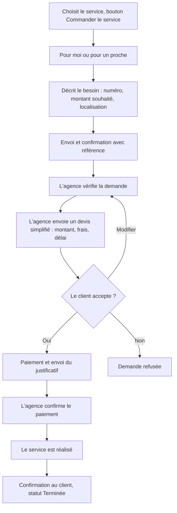
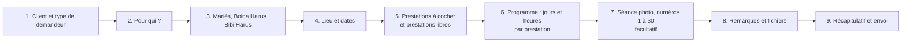
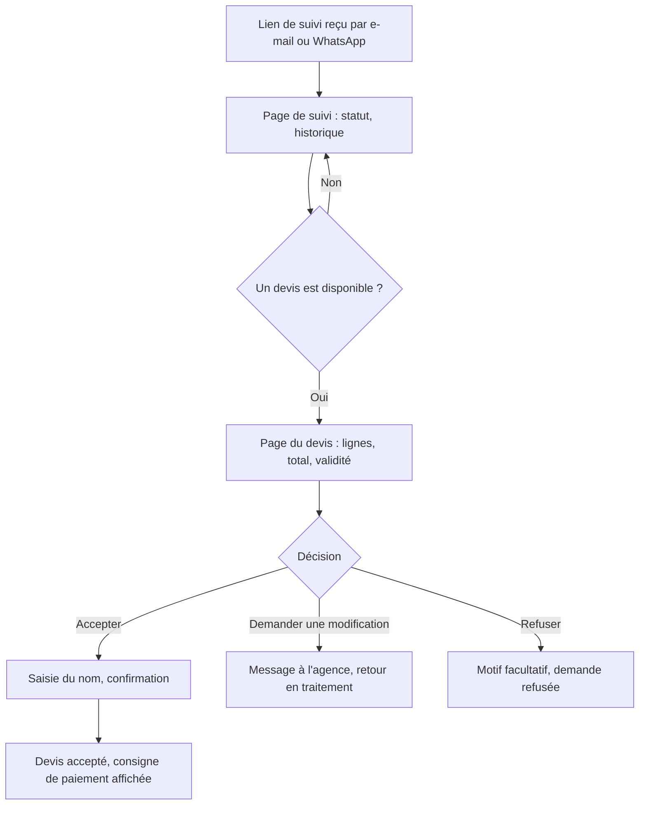
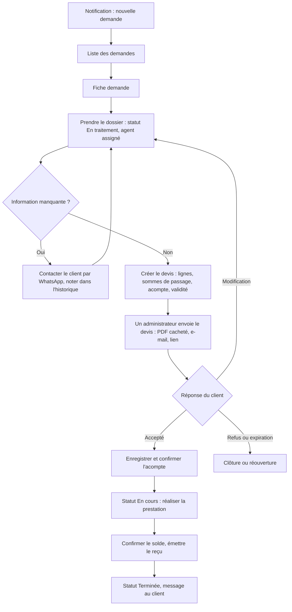
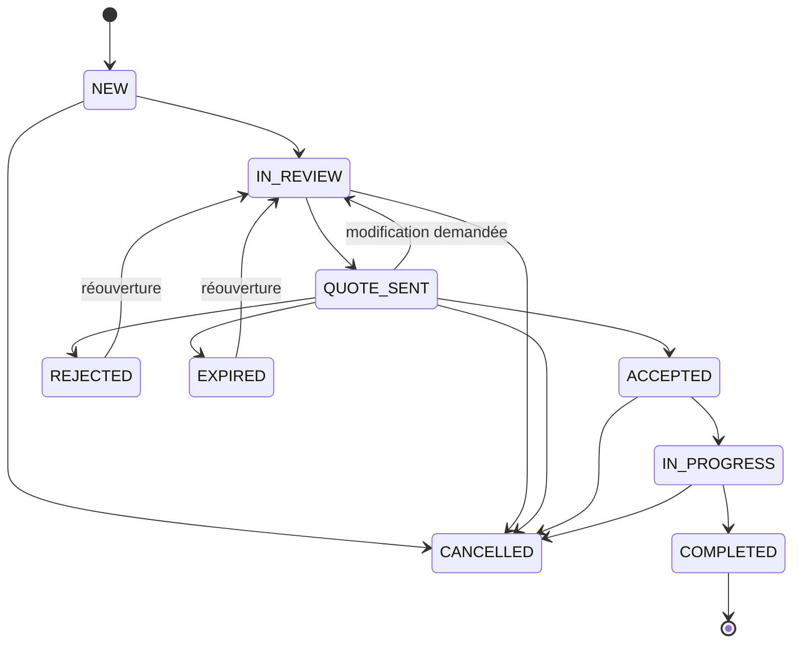
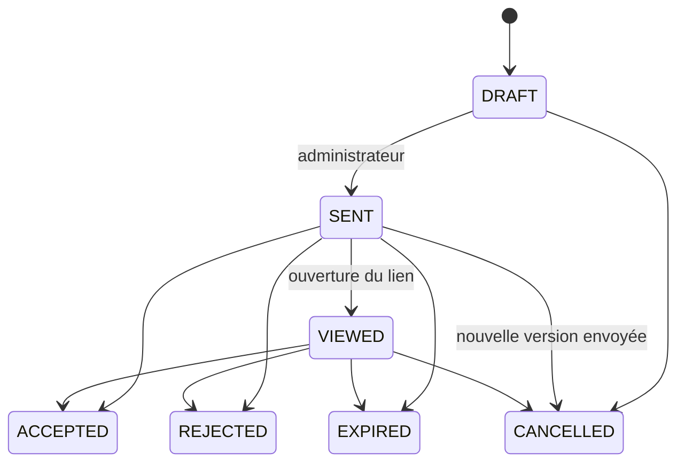
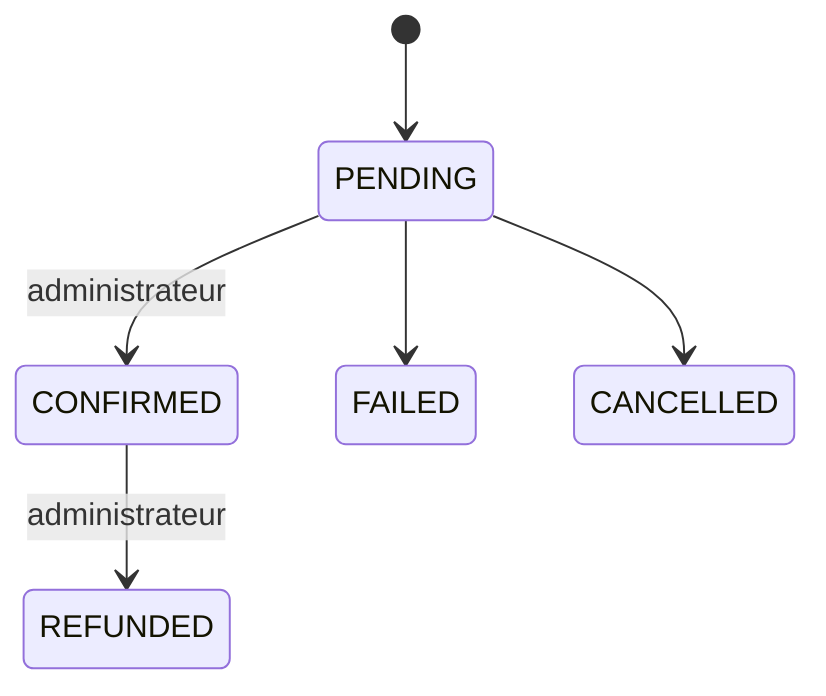

# App Flow — Parcours de l'application

**Dz Multi-Services** · Version 1.0 · 8 octobre 2026
Liens : [PRD](01-PRD.md) · [TRD](02-TRD.md) · [Design Brief](04-design-brief.md)

Ce document décrit ce que l'utilisateur voit et fait, écran par écran, et comment une demande avance. Les libellés sont ceux de l'interface.

---

## 1. Plan de l'application

## 2. Parcours du client

### 2.1 Demander un devis (prestation)

### 2.2 Commander un service à la demande

### 2.3 Commander pour un proche (diaspora)
1. Le client choisit « Pour un proche ».
2. Il renseigne **ses** coordonnées (nom, prénom, pays, téléphone, WhatsApp, e-mail).
3. Il renseigne le **bénéficiaire** (nom, prénom, téléphone, ville, région, adresse, relation).
4. Le reste du formulaire est celui du service choisi.
5. Un client déjà connu (même téléphone) est reconnu sans que ses données soient affichées ni modifiées.

### 2.4 Formulaire de mariage, étape par étape

Règles de l'écran « Programme » : une ligne par prestation et par journée ; la date doit être dans la période du mariage ; le jour de la semaine est affiché automatiquement ; une case « finit le lendemain » gère les heures après minuit ; le bouton « Ajouter une journée » ajoute une ligne.

### 2.5 Suivre sa demande et accepter un devis

## 3. Parcours de l'administration

### 3.1 Traiter une demande

### 3.2 Paiement
1. Le client paie selon la consigne (espèces, Wave, Orange Money, Holo, virement, autre) et envoie un justificatif.
2. Un agent ou un administrateur **enregistre** le paiement (statut En attente) avec référence et justificatif.
3. Un **administrateur** le **confirme** : date et auteur sont enregistrés, l'état de règlement de la demande est recalculé.
4. Un reçu PDF peut être émis.
5. Un paiement confirmé ne se modifie pas ; en cas d'erreur, on le rembourse ou on l'annule par un nouvel enregistrement.

## 4. États et transitions

### 4.1 Demande

| Statut | Libellé affiché | Qui le provoque |
|---|---|---|
| NEW | Demande reçue | Envoi du formulaire |
| IN_REVIEW | En traitement | Agent ou administrateur ; automatique à la création d'un devis |
| QUOTE_SENT | Devis envoyé | Automatique à l'envoi du devis |
| ACCEPTED | Acceptée | Automatique à l'acceptation du devis |
| IN_PROGRESS | En cours | Agent ou administrateur |
| COMPLETED | Terminée | Agent ou administrateur |
| REJECTED | Refusée | Refus du devis par le client |
| EXPIRED | Expirée | Automatique à l'échéance du devis |
| CANCELLED | Annulée | Agent ou administrateur, **motif obligatoire** |

### 4.2 Devis

Après l'envoi, les lignes et les montants ne changent plus : on crée une **nouvelle version**.

### 4.3 Paiement et règlement

État de règlement de la demande, calculé : **UNPAID** (aucun paiement confirmé), **PARTIAL** (confirmé inférieur au devis accepté), **PAID** (confirmé supérieur ou égal), **REFUNDED** (tout remboursé).

## 5. Écrans

Convention d'états : chaque écran prévoit un état **chargement** (squelette), **vide** (message et action), **erreur** (message clair, bouton réessayer).

### 5.1 Site public

| Écran | Contenu | Actions | Particularités |
|---|---|---|---|
| Accueil | Bandeau, section diaspora, services, comment ça marche, à propos, galerie, témoignages, FAQ, contact | Découvrir nos services, Commander pour un proche | Texte du bandeau et diaspora conformes au cahier des charges |
| Services | Cartes : icône, nom, description, bouton | Ouvrir un service | Services actifs seulement |
| Page de service | Image, description, prestations incluses, galerie, FAQ | Demander un devis ou Commander | Aucun prix |
| Formulaire | Barre de progression, champs de l'étape, boutons Précédent et Suivant | Suivant, Précédent, Envoyer | Erreurs en français ; brouillon local (mariage) |
| Confirmation | Référence, message, lien de suivi, bouton WhatsApp | Copier la référence, Suivre ma demande | Référence jamais seule porteuse d'accès |
| Suivi | Statut, historique, devis | Ouvrir le devis | `noindex` ; jeton invalide : message neutre |
| Devis | En-tête agence, lignes, total, acompte, validité | Accepter, Demander une modification, Refuser | Devis expiré : lecture seule |
| Contact | Formulaire, coordonnées de l'agence | Envoyer | Anti-spam |
| Pages légales | Mentions, conditions, confidentialité | | |

### 5.2 Administration

| Écran | Contenu | Actions |
|---|---|---|
| Connexion | E-mail, mot de passe, code de double authentification | Se connecter |
| Tableau de bord | Demandes du jour, devis en attente, prestations à venir, clients, encaissements du mois | Ouvrir une liste |
| Liste des demandes | Tableau filtrable (service, statut, date, local ou diaspora, agent) | Ouvrir, créer une demande, assigner |
| Fiche demande | Onglets : client, bénéficiaire, prestation, programme, fichiers, devis, paiements, notes internes, historique | Changer de statut, créer un devis, enregistrer un paiement, générer la fiche de prestation, message WhatsApp prérempli |
| Éditeur de devis | Lignes, case « somme de passage », remise, acompte, validité, conditions, aperçu PDF | Enregistrer, envoyer (administrateur), annuler, créer une version |
| Paiements | Liste avec filtres, justificatifs | Confirmer, rembourser (administrateur) |
| Clients | Fiches, bénéficiaires, historique | Rechercher, modifier, fusionner les doublons (V2) |
| Services | Catégories, services, ordre, publication, champs génériques | Modifier |
| Messages | Messages de contact et statuts | Marquer lu, en cours, résolu, archivé |
| Réglages | Coordonnées, logo, **cachet**, réseaux, horaires, validité des devis, taux d'acompte, modes de paiement | Enregistrer (cachet : super-administrateur) |
| Utilisateurs | Comptes, rôles, activation | Créer, désactiver (super-administrateur) |
| Journal | Actions, auteur, anciennes et nouvelles valeurs | Rechercher (super-administrateur) |

## 6. Notifications et messages

| Événement | Destinataire | Canal | Contenu |
|---|---|---|---|
| Demande enregistrée | Client | E-mail | Référence, lien de suivi |
| Nouvelle demande | Personnel | Interne | « Demande DZ-… » |
| Nouveau contact | Personnel | Interne | Nom de l'expéditeur |
| Devis envoyé | Client | E-mail, lien WhatsApp | Lien du devis, validité |
| Devis accepté | Personnel | Interne | Numéro du devis |
| Paiement confirmé | Personnel, client | Interne, e-mail | Montant, reçu |
| Prestation terminée | Client | E-mail | Remerciement |
| Devis proche de l'échéance | Personnel | Interne (V2) | Liste des devis |
| Prestation à venir | Personnel | Interne (V2) | J-7 et J-1 |

## 7. Cas limites

| Cas | Comportement |
|---|---|
| Jeton de suivi ou de devis invalide | Message neutre « Lien invalide ou expiré », sans indice |
| Double envoi du formulaire | Une seule demande créée |
| Téléphone déjà connu | Rattachement au client existant, données non écrasées, réconciliation par le personnel |
| Devis accepté deux fois | Refusé ; la première acceptation fait foi |
| Devis expiré | Lecture seule ; l'agence peut créer une nouvelle version |
| Fichier trop lourd ou type interdit | Refus avant l'envoi, avec message explicite |
| Paiement saisi sur un mauvais devis | Refusé par la base (le devis doit appartenir à la demande) |
| Agent tentant une action réservée | Refus clair ; l'action n'est pas proposée dans l'interface |
| Coupure de connexion pendant le formulaire | Brouillon conservé sur l'appareil |
