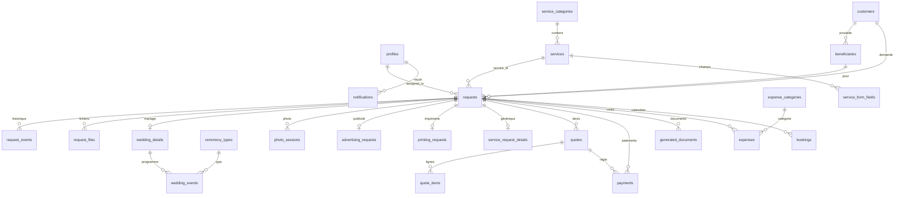

# Schéma de données (Background Schema)

**Dz Multi-Services** · Version 1.0 · 8 octobre 2026
Ce document décrit le schéma PostgreSQL de Supabase. Le code fait foi : `supabase/migrations/0001` à `0004`. Liens : [TRD](02-TRD.md) · [App Flow](03-app-flow.md) · [Plan d'implémentation](06-plan-implementation.md)

| Fichier | Contenu |
|---|---|
| `0001_schema.sql` | Types, tables, contraintes, index |
| `0002_functions_triggers.sql` | Rôles du personnel, numérotation, déclencheurs, vues financières, fonctions d'appel (RPC) |
| `0003_security.sql` | RLS, droits, stockage |
| `0004_seed.sql` | Données de départ |

Ordre d'application : 0001, 0002, 0003, 0004. Toute évolution passe par une **nouvelle migration**, jamais par une modification d'un fichier déjà appliqué.

---

## 1. Diagramme



## 2. Types énumérés

| Type | Valeurs |
|---|---|
| `app_role` | SUPER_ADMIN, ADMIN, AGENT |
| `service_type` | QUOTE, REQUEST |
| `request_type` | QUOTE, SERVICE_REQUEST |
| `request_status` | NEW, IN_REVIEW, QUOTE_SENT, ACCEPTED, IN_PROGRESS, COMPLETED, REJECTED, CANCELLED, EXPIRED |
| `payment_state` | UNPAID, PARTIAL, PAID, REFUNDED |
| `request_source` | SITE, WHATSAPP, PHONE, MANUAL |
| `customer_type` | LOCAL, DIASPORA |
| `quote_status` | DRAFT, SENT, VIEWED, ACCEPTED, REJECTED, EXPIRED, CANCELLED |
| `payment_status` | PENDING, CONFIRMED, FAILED, CANCELLED, REFUNDED |
| `contact_status` | NEW, READ, IN_PROGRESS, RESOLVED, ARCHIVED |
| `document_type` | QUOTE, SERVICE_SHEET, RECEIPT |

Les libellés français affichés sont dans l'application (voir App Flow § 4).

## 3. Tables

| Groupe | Table | Rôle |
|---|---|---|
| Accès | `profiles` | Personnel : identité, rôle, activation (id = identifiant d'authentification) |
| Catalogue | `service_categories`, `services`, `service_form_fields` | Catégories, services, champs des formulaires génériques |
| | `ceremony_types` | Prestations de mariage connues (liste modifiable) |
| Personnes | `customers` | Demandeurs ; téléphone normalisé, unique |
| | `beneficiaries` | Bénéficiaires rattachés à un client |
| Demandes | `requests` | Table centrale |
| | `request_events` | Historique métier, en partie visible du client |
| | `request_files` | Fichiers joints |
| Détails | `wedding_details`, `wedding_events` | Mariage et programme |
| | `photo_sessions` | Séances photo, avec `photo_numbers` (1 à 30) |
| | `advertising_requests`, `printing_requests` | Publicité, imprimerie |
| | `service_request_details` | Services à la demande (`jsonb`) |
| Commercial | `quotes`, `quote_items` | Devis versionnés et lignes |
| | `payments` | Paiements |
| | `generated_documents` | Documents PDF émis |
| Finance | `expense_categories`, `expenses` | Dépenses |
| | `bookings` | Calendrier (V2) |
| Contenus | `gallery_items`, `testimonials`, `faqs`, `site_settings`, `contact_messages` | Contenus du site |
| Système | `notifications`, `audit_logs`, `doc_counters` | Notifications, journal, compteurs de numérotation |

### 3.1 Points de conception

| Sujet | Choix |
|---|---|
| Clés | `uuid` partout, sauf `audit_logs` (identité numérique) |
| Montants | `numeric(14,2)`, devise portée par chaque montant ; devise par défaut `XOF` **à confirmer** (XOF ou KMF) |
| Téléphones | Format international vérifié par contrainte (`^\+[1-9][0-9]{6,14}$`) |
| Dates d'événements | `date` et `time` sans fuseau ; `ends_next_day` pour les heures après minuit |
| Bénéficiaire | Clé étrangère composite `(beneficiary_id, customer_id)` : un bénéficiaire ne peut être rattaché qu'à son client |
| Jetons publics | `public_token` aléatoire de 192 bits sur `requests` et `quotes` |
| Un seul devis accepté | Index unique partiel sur `quotes(request_id)` où le statut est ACCEPTED |
| Suppression | Logique (`deleted_at`) pour clients et bénéficiaires ; aucune politique de suppression pour paiements, journal, documents |
| Fichiers | Taille limitée à 25 Mo par contrainte ; types contrôlés côté serveur |
| Séance photo du mariage | Ligne `photo_sessions` rattachée à la **même demande** (et à `wedding_details`) ; `parent_request_id` sert aux ajouts ultérieurs |

### 3.2 Champs des formulaires, tels que la fiche papier

| Fiche papier | Colonne |
|---|---|
| Nom et prénom du client, ville, région, téléphone | `customers` |
| Noms et prénoms des mariés | `wedding_details.groom_name`, `bride_name` |
| Nom de Boina Harus, de Bibi Harus | `boina_harus_name`, `bibi_harus_name` |
| Lieu de prestation | `venue` |
| Début et fin de prestation | `start_date`, `end_date` |
| Grand Mariage, Karam, Mdhwahirisho, Pao, Mambizo | `ceremony_types` ; prestation libre : `wedding_events.custom_label` |
| Jours et heures de prestation | `wedding_events` (date, heures, `ends_next_day`) ; jour de la semaine déduit de la date |
| Séance photo, numéros 1 à 30 | `photo_sessions.photo_numbers` |

## 4. Déclencheurs

| Déclencheur | Rôle |
|---|---|
| `trg_*_updated_at` | Met à jour `updated_at` sur toutes les tables concernées |
| `trg_requests_reference` | Attribue `DZ-AAAA-NNNNNN` (compteur atomique) |
| `trg_quotes_number` | Attribue `DV-AAAA-NNNNN` |
| `trg_documents_number` | Attribue `RC-…` (reçu) ou `FP-…` (fiche de prestation) |
| `trg_requests_transition` | Refuse toute transition de statut non autorisée |
| `trg_requests_events` | Écrit l'historique à la création et à chaque changement de statut |
| `trg_quotes_guard` | Statuts de devis autorisés ; devis figé après envoi ; seul un administrateur envoie |
| `trg_quote_items_totals` | Recalcule sous-total et total ; refuse la modification d'un devis envoyé |
| `trg_quotes_sync` | Synchronise le statut de la demande (devis créé, envoyé, accepté, refusé, expiré) ; annule les versions précédentes à l'envoi d'une nouvelle |
| `trg_payments_guard` | Rattache le paiement au bon client, vérifie le devis, impose « en attente » à un agent, fige un paiement confirmé, renseigne qui a confirmé et quand |
| `trg_payments_refresh` | Recalcule `requests.payment_state` |
| `trg_*_notify` | Notifications internes (demande, contact, devis accepté, paiement confirmé) |
| `trg_*_audit` | Journal d'activité sur les tables sensibles |

## 5. Fonctions

### 5.1 Aides de droits (appelables par tous, retournent un booléen ou le rôle)
`staff_role()`, `is_staff()`, `is_admin()`, `is_super()` : lisent `profiles` pour l'utilisateur connecté, en tenant compte de `is_active`. Le rôle n'est **jamais** lu dans des métadonnées modifiables.

### 5.2 Fonctions d'appel, réservées au serveur (`service_role`)

| Fonction | Rôle |
|---|---|
| `submit_request(jsonb)` | Crée en une transaction : client (ou rattachement au client existant), bénéficiaire, demande, détails selon le service, fichiers. Retourne `reference` et `public_token` |
| `submit_contact(jsonb)` | Enregistre un message de contact |
| `get_request_public(token)` | Statut, historique visible, devis envoyés |
| `get_quote_public(token)` | Contenu du devis ; passe en « consulté » à la première lecture |
| `accept_quote(token, nom)` | Accepte (vérifie statut et validité) ; verrou de ligne contre la double acceptation |
| `reject_quote(token, motif)`, `request_quote_change(token, message)` | Refus ; demande de modification (retour en traitement) |
| `expire_quotes()` | Expire les devis échus ; à planifier chaque nuit |
| `refresh_payment_state(request)`, `next_doc_number(...)` | Internes, non appelables depuis le client |

Format de `submit_request` :

```json
{
  "service_slug": "filmage-mariage",
  "consent": true,
  "customer": { "first_name": "", "last_name": "", "phone": "+33...", "email": "", "country": "", "customer_type": "DIASPORA" },
  "beneficiary": { "first_name": "", "last_name": "", "phone": "", "city": "", "relationship": "" },
  "description": "",
  "details": {
    "requester_role": "MARIE", "groom_name": "", "bride_name": "", "boina_harus_name": "", "bibi_harus_name": "",
    "venue": "", "start_date": "2026-11-20", "end_date": "2026-11-21",
    "events": [ { "ceremony_code": "PAO", "event_date": "2026-11-20", "start_time": "18:00", "end_time": "23:00" },
                { "custom_label": "Soirée", "event_date": "2026-11-21", "start_time": "21:00", "ends_next_day": true } ],
    "photo_numbers": [1, 5, 30]
  },
  "files": [ { "file_name": "carton.pdf", "file_path": "incoming/<uuid>/carton.pdf", "mime_type": "application/pdf", "file_size": 12345 } ]
}
```

Le champ `details` dépend du `form_key` du service (`wedding`, `photo`, `advertising`, `printing`, `generic`).

## 6. Sécurité (RLS)

RLS est activé sur **toutes** les tables. Les droits sont retirés aux rôles `anon` et `authenticated`, puis accordés au strict nécessaire ; les politiques filtrent ensuite les lignes.

| Table ou groupe | Visiteur (anon) | Agent | Administrateur | Super-administrateur |
|---|---|---|---|---|
| Services, catégories, champs, types de cérémonie | Lecture des éléments actifs | Lecture | Lecture et écriture | Idem |
| Galerie, témoignages, FAQ | Lecture des éléments publiés | Lecture | Lecture et écriture | Idem |
| `site_settings` | Lecture des réglages publics | Lecture des publics | Tout | Tout |
| Clients, bénéficiaires, demandes, détails, fichiers, événements | Aucun accès | Lecture, création, modification | Idem | Idem |
| Devis et lignes | Aucun (accès par fonctions) | Brouillons : tout ; envoi interdit | Tout, envoi autorisé | Idem |
| Paiements | Aucun | Lecture, création « en attente » | Confirmation, remboursement | Idem |
| Dépenses | Aucun | Aucun | Tout | Tout |
| Documents générés | Aucun | Lecture, création | Idem | Idem |
| Profils | Aucun | Lecture ; modification de son propre profil sans changer son rôle | Lecture | Tout |
| Notifications | Aucun | Les siennes | Les siennes | Les siennes |
| Journal | Aucun | Aucun | Aucun | Lecture seule |
| Compteurs | Aucun | Aucun | Aucun | Aucun (fonctions seulement) |

Aucune politique de **suppression** sur paiements, journal, documents, demandes ; seuls les brouillons de devis peuvent être supprimés.

### Stockage

| Bucket | Public | Accès |
|---|---|---|
| `site-assets` | Oui | Écriture : administrateurs |
| `gallery` | Oui | Écriture : administrateurs |
| `request-files` | Non | Envoi par URL signée créée par le serveur ; lecture : personnel |
| `documents` | Non | PDF émis ; lecture : personnel ; liens signés à durée limitée |
| `agency-assets` | Non | **Cachet et logo des PDF : aucune politique**, lecture et écriture par le serveur seulement |
| `avatars` | Non | Lecture : personnel |

## 7. Vues financières

| Vue | Colonnes | Usage |
|---|---|---|
| `v_request_amounts` | total du devis accepté, somme de passage, revenu de l'agence, encaissé, reste à encaisser | Fiche demande, tableau de bord |
| `v_monthly_finance` | par mois et devise : encaissé, revenu encaissé de l'agence (au prorata), dépenses, résultat | Finance (V2) |

Les vues sont en `security_invoker` : elles respectent RLS (un agent ne voit donc pas les dépenses).

Règle de calcul : revenu de l'agence = total du devis accepté − lignes marquées « somme de passage ». Chaque paiement confirmé est réparti au prorata de ce ratio.

## 8. Données de départ

- 5 types de cérémonies : Grand Mariage, Karam, Mdhwahirisho, Pao, Mambizo.
- 2 catégories et 9 services (4 prestations, 5 services à la demande), avec formulaire et icône.
- 9 catégories de dépenses.
- Réglages : nom, signature, téléphones, e-mail, adresse, WhatsApp, réseaux, horaires, modes de paiement, validité des devis (15 jours), taux d'acompte (30 %, **à confirmer**), taille maximale des fichiers, chemin du cachet.

Les téléphones, l'e-mail et l'adresse sont à renseigner par l'agence dans les réglages.

## 9. Tâches planifiées

```sql
-- à activer avec pg_cron (une fois par nuit)
select cron.schedule('expire-quotes', '5 0 * * *', $$select public.expire_quotes()$$);
```

Prévus ensuite : rappels de prestations (V2), purge des fichiers selon la durée de conservation.

## 10. Vérification réalisée

Les quatre migrations ont été rejouées sur un PostgreSQL local avec une imitation des schémas `auth` et `storage` de Supabase, puis **50 vérifications** ont réussi :

- soumissions de mariage (3 événements, séance photo, fichier), de service générique et d'imprimerie ; refus sans consentement et avec téléphone invalide ; client existant rattaché sans doublon ;
- visiteur : lecture des services seulement, accès refusé aux demandes, aux fonctions d'appel ;
- agent : transitions interdites refusées, devis brouillon et lignes, envoi refusé, paiement confirmé refusé, paiement en attente accepté, dépenses invisibles, changement de rôle refusé ;
- administrateur : envoi du devis, devis figé, totaux inchangés, confirmation du paiement, état de règlement (partiel puis payé), paiement confirmé non modifiable, suppression sans effet ;
- client via le serveur : consultation, double acceptation refusée, jeton invalide ;
- finance : sommes de passage exclues du revenu, résultat mensuel exact ; journal lisible par le super-administrateur seulement et non modifiable ; numérotation correcte.

Le script se trouve dans `supabase/tests/harness/test_schema.py`. À reprendre en tests pgTAP dans le dépôt, et à rejouer sur un vrai projet Supabase (l'imitation ne couvre pas l'extension `pgcrypto`, `pg_cron` ni les politiques de stockage réelles).

## 11. Évolutions prévues

| Sujet | Version |
|---|---|
| Interface d'administration de la galerie, des témoignages, de la FAQ | V2 |
| Calendrier alimenté depuis `wedding_events` | V2 |
| Fusion des doublons de clients | V2 |
| Paiements en ligne : table de transactions avec le prestataire | V3 |
| Comptes clients : liaison `customers` et authentification | V3 |
| Traductions des contenus | V3 |
