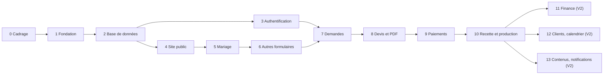

# Plan d'implémentation

**Dz Multi-Services** · Version 1.0 · 8 octobre 2026
Liens : [PRD](01-PRD.md) · [TRD](02-TRD.md) · [Schéma de données](05-schema-donnees.md) · [App Flow](03-app-flow.md) · [Design Brief](04-design-brief.md)

---

## 1. Principes

1. **Un lot à la fois**, une branche `feature/*` par lot, une revue avant fusion dans `develop`.
2. **La base d'abord** : schéma, droits et tests avant l'interface. Les migrations sont déjà écrites et testées (lot 2 : à rejouer sur Supabase).
3. **Chaque lot se termine par un critère de validation** vérifiable.
4. **Jamais de demande du type « crée tout le site »** à l'assistant : une consigne par lot, avec `AGENTS.md` et les documents en contexte.
5. **Mise en ligne pilote à la fin du lot 10** (V1) ; les versions suivantes viennent après retour d'usage.

## 2. Vue d'ensemble

| Lot | Contenu | Dépend de | Jours (indicatif) | Version |
|---|---|---|---|---|
| 0 | Cadrage et décisions | — | 3 | V1 |
| 1 | Fondation du projet | 0 | 2 | V1 |
| 2 | Base de données et sécurité | 1 | 3 | V1 |
| 3 | Authentification et rôles | 2 | 3 | V1 |
| 4 | Site public et catalogue | 2 | 6 | V1 |
| 5 | Formulaire de mariage | 4 | 7 | V1 |
| 6 | Autres formulaires et contact | 5 | 6 | V1 |
| 7 | Gestion des demandes | 3, 6 | 6 | V1 |
| 8 | Devis et documents PDF | 7 | 8 | V1 |
| 9 | Paiements et tableau de bord | 8 | 6 | V1 |
| 10 | Revue de sécurité, recette, mise en production pilote | 9 | 6 | V1 |
| 11 | Dépenses, finance, rapports | 10 | 6 | V2 |
| 12 | Clients, bénéficiaires, calendrier | 10 | 6 | V2 |
| 13 | Contenus et notifications client | 10 | 6 | V2 |

**Total V1 : environ 56 jours de travail** (un développeur assisté par l'IA). Les estimations sont indicatives : à temps plein cela représente 11 à 12 semaines ; à mi-temps, 22 à 24 semaines. Les lots 0 et 2 ont des gains rapides, car le schéma est déjà écrit et testé.



## 3. Définition de « terminé » (pour chaque lot)

- [ ] Les critères du lot sont satisfaits et démontrés.
- [ ] Code relu, lint et vérification des types sans erreur.
- [ ] Tests ajoutés (unitaires, base de données, parcours) et verts.
- [ ] Toute modification de base passe par une migration versionnée.
- [ ] Aucun secret dans le dépôt ; aucune clé privilégiée côté navigateur.
- [ ] Interface en français, vérifiée sur petit écran.
- [ ] Documentation du dossier `docs/` mise à jour.
- [ ] Préversion Netlify fonctionnelle.

## 4. Détail des lots

### Lot 0 — Cadrage et décisions (3 j)
**Tâches** : obtenir les réponses aux points ouverts du PRD § 11 (priorité : pays et devise, paiement de la diaspora, cadre légal, signification des numéros 1 à 30) ; rassembler cachet (PNG fond transparent), téléphones, e-mail, adresse, fichiers vectoriels du logo, photos ; valider la matrice de permissions ; choisir le nom de domaine.
**Livrable** : note de décisions signée par l'agence.
**Validation** : aucune question bloquante restante pour le lot 2.

### Lot 1 — Fondation (2 j)
**Tâches** : dépôt GitHub (`main`, `develop`), projet Next.js TypeScript, Tailwind, shadcn/ui, thème de la charte (jetons du Design Brief § 16), polices Montserrat et Poppins, deux projets Supabase (développement, production), Netlify relié au dépôt, `AGENTS.md`, dossier `docs/`, CI minimale ; **essai de génération d'un PDF avec police et image** sur Netlify (lève le risque principal du TRD).
**Validation** : page d'accueil vide déployée en préversion avec la charte appliquée ; PDF de test généré.

### Lot 2 — Base de données et sécurité (3 j)
**Tâches** : appliquer les migrations 0001 à 0004 sur le projet de développement ; vérifier `pgcrypto` ; activer `pg_cron` ; régénérer les types TypeScript ; porter les 50 vérifications en tests pgTAP ; renseigner les réglages (coordonnées) ; créer le premier super-administrateur ; configurer les buckets.
**Validation** : migrations rejouables de zéro ; tests de sécurité verts ; un visiteur ne lit aucune donnée privée.

### Lot 3 — Authentification et rôles (3 j)
**Tâches** : `@supabase/ssr` (clients navigateur, serveur, service), page de connexion, déconnexion, session persistante, garde des routes `/admin`, lecture du rôle, double authentification pour ADMIN et SUPER_ADMIN, gestion des utilisateurs par le super-administrateur.
**Validation** : un agent n'ouvre pas les pages réservées ; test automatique : aucune clé `service_role` dans les bundles.

### Lot 4 — Site public et catalogue (6 j)
**Tâches** : en-tête, pied de page (coordonnées lues des réglages), accueil (bandeau, section diaspora), liste et pages de service alimentées par la base, comment ça marche, à propos, FAQ, contact (affichage), pages légales, bouton WhatsApp, métadonnées, plan du site, revalidation à la demande.
**Validation** : aucune donnée en dur ; Lighthouse mobile ≥ 90 ; mobile validé.

### Lot 5 — Formulaire de mariage (7 j)
**Tâches** : étapes 1 à 9 (App Flow § 2.4), bloc « Pour qui ? » réutilisable, prestations connues et libres, planning dynamique (jour de la semaine, fin le lendemain), grille 1 à 30, téléversement par URL signée, Turnstile, récapitulatif, brouillon local, appel de `submit_request`, écran de confirmation avec référence, e-mail de confirmation.
**Validation** : une demande complète (deux jours, un événement après minuit, fichier, bénéficiaire) est enregistrée et visible en base.

### Lot 6 — Autres formulaires et contact (6 j)
**Tâches** : séance photo, spot publicitaire, imprimerie, formulaire générique piloté par `service_form_fields` (champs propres à chaque service, double saisie du numéro de compteur), contact, limitation de débit, messages d'erreur.
**Validation** : chaque service crée sa demande ; les données de contrôle (formats, montants) sont refusées quand elles sont invalides.

### Lot 7 — Gestion des demandes (6 j)
**Tâches** : liste avec filtres, fiche à onglets, changement de statut (transitions de la base), assignation, notes internes, historique, création manuelle (WhatsApp, téléphone), notifications internes, messages de contact.
**Validation** : traitement complet d'une demande de la réception à la préparation d'un devis.

### Lot 8 — Devis et documents PDF (8 j)
**Tâches** : éditeur de devis (lignes, somme de passage, remise, acompte, validité, conditions), versions, envoi (administrateur), pages publiques de suivi et de devis (consulter, accepter, modifier, refuser), génération des PDF **devis, fiche de prestation de mariage, reçu** avec en-tête et cachet, upload du cachet par le super-administrateur, e-mail du devis, lien WhatsApp prérempli, expiration planifiée.
**Validation** : devis envoyé, accepté par lien avec trace ; PDF conforme au Design Brief § 12.4 ; le cachet n'est jamais accessible hors serveur ; un brouillon n'est pas cacheté.

### Lot 9 — Paiements et tableau de bord (6 j)
**Tâches** : enregistrement par l'agent, confirmation par l'administrateur, justificatif, remboursement, reçu PDF, état de règlement, vue `v_request_amounts`, tableau de bord simple (demandes du jour, devis en attente, prestations à venir, encaissements).
**Validation** : paiement partiel puis soldé donne les bons états ; les sommes de passage sont exclues du revenu ; un paiement confirmé ne se modifie pas.

### Lot 10 — Revue de sécurité, recette, mise en production pilote (6 j)
**Tâches** : revue des politiques RLS et des en-têtes, test d'intrusion simple (énumération, accès anonyme, élévation de rôle), tests de bout en bout, accessibilité (axe), performance, essais sur téléphones réels et connexion lente, sauvegarde et **test de restauration**, offre Supabase de production, domaine, e-mails authentifiés, données réelles de l'agence, formation des utilisateurs, procédure de support.
**Validation** : critères du PRD § 9 satisfaits ; liste de contrôle du § 6 complétée ; décision de mise en ligne signée.

### Lots 11 à 13 (V2)
- **11** : dépenses, catégories, justificatifs, finance (`v_monthly_finance`), rapports, graphiques, exports.
- **12** : clients et bénéficiaires complets, fusion des doublons, calendrier alimenté par les programmes de mariage, détection des conflits, affectation.
- **13** : gestion de la galerie, des témoignages, de la FAQ ; notifications automatiques vers le client ; rappels de prestations ; purge des fichiers selon la durée de conservation.

## 5. Consigne type pour l'assistant (Windsurf)

```text
Contexte : lis AGENTS.md, docs/01-PRD.md, docs/02-TRD.md et la section concernée
de docs/03-app-flow.md et docs/05-schema-donnees.md.
Tâche : réaliser le lot N, [intitulé], et rien d'autre.
Contraintes : respecter les règles de sécurité d'AGENTS.md ; toute modification de
la base par migration ; aucune couleur ni police en dur (jetons du Design Brief) ;
interface en français ; ne pas modifier les lots déjà validés.
Livrable : code, migrations, tests, mise à jour de docs/.
Vérifications : lancer lint, types, tests et build ; lister les fichiers modifiés ;
signaler toute décision qui s'écarte des documents.
```

**Consignes par lot (à ajouter à la consigne type)**

| Lot | Précision à donner |
|---|---|
| 1 | « Mets en place le thème issu de docs/04-design-brief.md § 16 et un essai de PDF avec les polices Montserrat et Poppins sur Netlify. » |
| 2 | « Applique les migrations de supabase/migrations dans l'ordre, génère les types, écris les tests pgTAP équivalents à supabase/tests/harness. » |
| 3 | « Utilise @supabase/ssr. Le client service_role n'existe que dans lib/supabase/service.ts. Ajoute le test de bundle. » |
| 5 | « Le formulaire doit appeler uniquement l'action serveur submitRequest, qui appelle la fonction SQL submit_request. N'écris jamais dans les tables depuis le navigateur. » |
| 8 | « Les montants viennent de la base. Le cachet est lu côté serveur depuis agency-assets et n'est jamais envoyé au navigateur. » |
| 9 | « La confirmation d'un paiement est réservée aux administrateurs, vérifiée par la base ; l'interface ne fait que masquer le bouton. » |

## 6. Liste de contrôle avant la mise en production

**Sécurité**
- [ ] RLS activé sur toutes les tables ; tests de droits verts sur la base de production.
- [ ] Aucune clé secrète dans le dépôt ni dans les bundles ; clé `service_role` en variable serveur.
- [ ] Double authentification active pour les administrateurs ; comptes de test supprimés.
- [ ] Anti-spam et limitation de débit actifs.
- [ ] Bucket `agency-assets` sans politique ; cachet inaccessible depuis un navigateur.
- [ ] En-têtes de sécurité et politique de contenu en place.

**Données**
- [ ] Sauvegarde automatique active, restauration testée.
- [ ] Réglages réels saisis (téléphones, e-mail, adresse, cachet, modes de paiement, validité, acompte).
- [ ] Données de test purgées.

**Conformité**
- [ ] Mentions légales, conditions, confidentialité publiées.
- [ ] Cadre légal des opérations financières vérifié ; sinon ces services restent masqués.

**Qualité**
- [ ] Lighthouse et axe satisfaisants ; essais sur téléphones réels.
- [ ] Domaine, certificat, e-mails authentifiés (SPF, DKIM).
- [ ] Contrôle de disponibilité et alertes en place.
- [ ] Procédure de retour arrière documentée.

## 7. Déploiement et retour arrière

1. Fusion de `develop` vers `main` après validation de la préversion.
2. Application des migrations sur la base de production par commande protégée, **avant** le déploiement de l'application si elles sont compatibles avec l'ancienne version.
3. Déploiement Netlify ; vérification des parcours critiques (accueil, envoi d'une demande de test, connexion administrateur).
4. **Retour arrière** : republier le déploiement précédent depuis Netlify ; pour la base, ne jamais défaire une migration à la main : écrire une migration corrective ; restauration de sauvegarde en dernier recours.

## 8. Risques du planning

| Risque | Effet | Parade |
|---|---|---|
| Décisions du lot 0 tardives | Retard sur paiements et formulaires | Avancer sur les lots 1 à 4 pendant le cadrage |
| Photos, cachet, logos vectoriels non fournis | Rendu provisoire | Demander dès le lot 0 ; maquettes provisoires |
| PDF impossible en fonction serverless | Replanification du lot 8 | Essai au lot 1 |
| Complexité du formulaire de mariage | Dépassement du lot 5 | Livrer d'abord sans brouillon local ni séance photo, puis compléter |
| Disponibilité du développeur (études, missions) | Calendrier long | Lots courts, jalons hebdomadaires, démonstration à l'agence à chaque lot |
| Retours de l'agence après démonstration | Reprises | Valider les maquettes avant les lots 5 et 8 |

## 9. Jalons et démonstrations

| Jalon | Fin du lot | Démonstration à l'agence |
|---|---|---|
| J1 | 4 | Site public avec vrais services et charte appliquée |
| J2 | 6 | Envoi d'une vraie demande de mariage depuis un téléphone |
| J3 | 8 | Traitement d'une demande et devis PDF cacheté |
| J4 | 10 | Parcours complet jusqu'au paiement, mise en ligne pilote |
